<div align="center">

# Lab CCNA - Réseau d'entreprise redondant OSPF, MST et VRRP

**Simulation d'une infrastructure réseau avec routage dynamique, haute disponibilité de passerelle,**  
**agrégation de liens, spanning-tree multi-instances et accès Internet via NAT**


</div>

---

## Sommaire

- [Présentation](#présentation)
- [Topologie](#topologie)
- [Plan d'adressage](#plan-dadressage)
- [Fonctionnalités mises en œuvre](#fonctionnalités-mises-en-œuvre)
- [Détail des équipements](#détail-des-équipements)
- [Administration](#administration)
- [Concepts CCNA couverts](#concepts-ccna-couverts)
- [Ordre de déploiement](#ordre-de-déploiement)
- [Commandes de vérification](#commandes-de-vérification)
- [Structure du dépôt](#structure-du-dépôt)
- [Captures de validation](#captures-de-validation)

---

## Présentation

Ce projet a été donné en cours aux étudiants de 3e année Cybersécurité et Investigation Numérique de l'École Nationale Supérieure Polytechnique de Yaoundé (ENSPY). Il simule l'infrastructure réseau d'un site d'entreprise composé d'un fournisseur d'accès, de deux routeurs de distribution, d'une paire de switchs d'agrégation de niveau 3 et de deux switchs d'accès. Il couvre les compétences CCNA2 et CCNA3 : OSPF mono-aire, routage inter-VLAN par SVI, VRRP, EtherChannel PAgP et LACP, MST, VTP, relais DHCP et NAT avec surcharge.

### Situation

À l'ENSPY, la filière AHN (Arts et Humanités Numériques) du génie informatique regroupe spécialités, dont HN, AN, CIN et ICD. Leurs salles et leurs postes sont reliés au même réseau, qui dépendait d'un seul routeur, d'un seul switch central et d'un seul lien vers Internet. Un lundi matin, le switch central tombe en panne : les quatre filières perdent à la fois le réseau local, l'accès à Internet et les ressources partagées. La coupure dure plusieurs heures, les cours et les travaux pratiques s'arrêtent.

L'administration demande un réseau qui continue de fonctionner quand un équipement ou un lien tombe, qui répartit la charge entre ses équipements, qui distribue les adresses automatiquement et qui reste administrable à distance.

### Solution apportée par la topologie

| Problème rencontré | Réponse de la topologie |
|---|---|
| Un seul lien vers Internet | Le FAI est relié à deux routeurs de distribution, RO-11 et RO-12, chacun avec son NAT |
| Un seul switch central | Deux switchs d'agrégation, AG1 et AG2, auxquels chaque switch d'accès est relié par un EtherChannel et un trunk croisé |
| Une seule passerelle par filière | VRRP : une adresse virtuelle `.254` par VLAN, reprise automatiquement par l'autre switch en cas de panne |
| Un lien de niveau 2 bloqué et inutilisé | MST à deux instances : AG1 racine des VLANs 225 et 235, AG2 racine des VLANs 245 et 255 |
| Un seul lien entre deux équipements | EtherChannel PAgP (AG-SW) et LACP (AG1-AG2) |
| Un seul serveur DHCP | RO-11 et RO-12 avec des pools complémentaires, joints par les relais DHCP des switchs d'agrégation |
| Routes à maintenir à la main | OSPF en aire 0, avec la route par défaut injectée par le FAI |
| Équipements difficiles à joindre | VLAN 211 de gestion et loopbacks sur chaque équipement |

Le réseau est conçu pour qu'une panne d'un switch d'agrégation, d'un routeur de distribution ou d'un lien ne coupe plus le service. La capture `Bascule_VRRP.png` le montre : AG2 est arrêté et AG1 reprend les passerelles des VLANs 245 et 255.

### Objectifs
- Concevoir un plan d'adressage IP structuré avec des liens point-à-point en /30
- Assurer la **haute disponibilité** à chaque niveau : double accès Internet, double agrégation, double passerelle par VLAN
- Répartir la charge entre les deux switchs d'agrégation grâce à **MST** et **VRRP**
- Distribuer les adresses par **DHCP** depuis deux serveurs complémentaires via des relais
- Fournir un accès Internet aux VLANs internes grâce au **NAT**

---

## Topologie

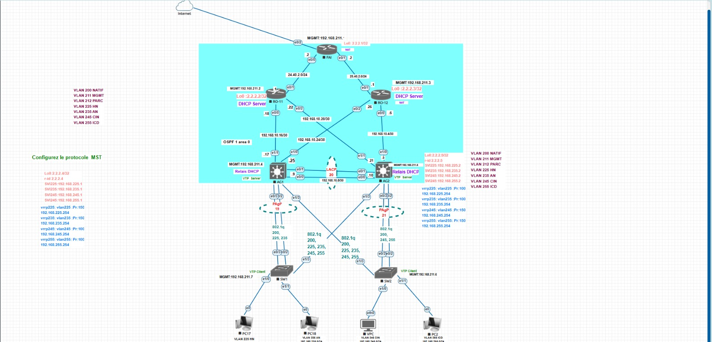

Le réseau est organisé en quatre couches :

| Couche | Équipements | Rôle |
|---|---|---|
| **Accès Internet** | FAI | Sortie vers Internet, NAT, injection de la route par défaut dans OSPF |
| **Distribution** | RO-11, RO-12 | Routeurs de distribution, serveurs DHCP, NAT |
| **Agrégation** | AG1, AG2 | Switchs L3, passerelles VRRP, racines MST, relais DHCP |
| **Accès** | SW1, SW2 | Switchs L2, ports utilisateurs, clients VTP |

---

## Plan d'adressage

### VLANs

| VLAN | Nom | Réseau | VIP VRRP | SVI AG1 | SVI AG2 |
|---|---|---|---|---|---|
| 200 | NATIF | - | - | - | - |
| 211 | MGMT | `192.168.211.0/24` | - | `.4` | `.5` |
| 212 | PARC | - | - | - | - |
| 225 | HN | `192.168.225.0/24` | `.254` | `.1` | `.2` |
| 235 | AN | `192.168.235.0/24` | `.254` | `.1` | `.2` |
| 245 | CIN | `192.168.245.0/24` | `.254` | `.1` | `.2` |
| 255 | ICD | `192.168.255.0/24` | `.254` | `.1` | `.2` |

Les VLANs 225, 235, 245 et 255 correspondent aux filières HN, AN, CIN et ICD de la filière AHN. Le VLAN 211 est dédié à la gestion, le VLAN 200 est le VLAN natif des trunks et le VLAN 212 (PARC) est déclaré sur les switchs.

### Liens point-à-point (/30) et liens FAI

| Segment | Réseau | Côté A | Côté B |
|---|---|---|---|
| RO-11 ↔ AG1 | `192.168.10.16/30` | RO-11 e0/0 `.18` | AG1 e1/1 `.17` |
| RO-11 ↔ AG2 | `192.168.10.20/30` | RO-11 e0/2 `.22` | AG2 e1/1 `.21` |
| RO-12 ↔ AG2 | `192.168.10.4/30` | RO-12 e0/0 `.6` | AG2 e1/0 `.5` |
| RO-12 ↔ AG1 | `192.168.10.24/30` | RO-12 e0/2 `.26` | AG1 e1/0 `.25` |
| AG1 ↔ AG2 (Po20) | `192.168.10.8/30` | AG1 Po20 `.9` | AG2 Po20 `.10` |
| FAI ↔ RO-11 | `24.40.2.0/24` | FAI e0/0 `.2` | RO-11 e0/1 `.1` |
| FAI ↔ RO-12 | `25.40.2.0/24` | FAI e0/1 `.2` | RO-12 e0/1 `.1` |
| FAI ↔ Internet | DHCP | FAI e0/2 | Nuage Internet |

### Loopbacks et gestion

| Équipement | Loopback0 (router-id) | Adresse de gestion |
|---|---|---|
| FAI | `2.2.2.1/32` | `192.168.211.1/32` (Loopback1) |
| RO-11 | `2.2.2.2/32` | `192.168.211.2/32` (Loopback1) |
| RO-12 | `2.2.2.3/32` | `192.168.211.3/32` (Loopback1) |
| AG1 | `2.2.2.4/32` | `192.168.211.4/24` (SVI VLAN 211) |
| AG2 | `2.2.2.5/32` | `192.168.211.5/24` (SVI VLAN 211) |
| SW2 | - | `192.168.211.6/24` (SVI VLAN 211) |
| SW1 | - | `192.168.211.7/24` (SVI VLAN 211) |

### DHCP - pools répartis entre RO-11 et RO-12

| VLAN | Passerelle | RO-11 (moitié basse) | RO-12 (moitié haute) |
|---|---|---|---|
| 225 | `192.168.225.254` | `.10` → `.127` | `.128` → `.253` |
| 235 | `192.168.235.254` | `.10` → `.127` | `.128` → `.253` |
| 245 | `192.168.245.254` | `.10` → `.127` | `.128` → `.253` |
| 255 | `192.168.255.254` | `.10` → `.127` | `.128` → `.253` |

Le DNS distribué est `8.8.8.8`.

---

## Fonctionnalités mises en œuvre

### Haute disponibilité

| Technologie | Configuration |
|---|---|
| **VRRP** | AG1 maître sur les VLANs 225 et 235 (priorité 150), AG2 maître sur les VLANs 245 et 255 (priorité 150), l'autre switch en secours (priorité 100) |
| **MST** | Région `ENSPY`, révision 1. Instance 1 = VLANs 225 et 235 (racine AG1), instance 2 = VLANs 245 et 255 (racine AG2), instance 0 racine AG1 |
| **EtherChannel LACP** | Port-channel 20 (e0/0-1) entre AG1 et AG2, lien routé en `192.168.10.8/30` |
| **EtherChannel PAgP** | Port-channel 19 entre AG1 et SW1, Port-channel 21 entre AG2 et SW2 (e0/2-3, trunks 802.1q) |
| **Trunks croisés** | AG1 e1/3 ↔ SW2 e1/3 et AG2 e1/3 ↔ SW1 e1/3 pour la double connexion des switchs d'accès |
| **OSPF multi-chemins** | Chaque switch d'agrégation est relié aux deux routeurs de distribution, chaque routeur à FAI |

### Services réseau

| Service | Détail |
|---|---|
| **OSPF** | Processus 1, aire 0 unique, interfaces SVI en passif, route par défaut injectée par FAI (`default-information originate always`) |
| **VTP** | Domaine `ENSPY`, version 2, AG1 et AG2 serveurs, SW1 et SW2 clients |
| **DHCP** | Deux serveurs (RO-11 et RO-12) avec pools complémentaires, relais `ip helper-address` sur les SVI de AG1 et AG2 |
| **NAT** | Surcharge sur FAI (sortie Internet) et sur RO-11 et RO-12 (sortie vers FAI) |
| **Routage inter-VLAN** | Via SVI sur AG1 et AG2 avec `ip routing` |

---

## Détail des équipements

| Équipement | Rôle | Points clés |
|---|---|---|
| **FAI** | Fournisseur d'accès simulé | NAT overload sur e0/2, OSPF, route par défaut injectée |
| **RO-11** | Routeur de distribution | Serveur DHCP (moitié basse), NAT, OSPF |
| **RO-12** | Routeur de distribution | Serveur DHCP (moitié haute), NAT, OSPF |
| **AG1** | Agrégation L3 | VTP server, racine MST 0 et 1, VRRP maître 225/235, Po19 PAgP, Po20 LACP |
| **AG2** | Agrégation L3 | VTP server, racine MST 2, VRRP maître 245/255, Po21 PAgP, Po20 LACP |
| **SW1** | Accès L2 | VTP client, PC17 (VLAN 225), PC18 (VLAN 235), Po19 PAgP |
| **SW2** | Accès L2 | VTP client, VPC (VLAN 245), PC2 (VLAN 255), Po21 PAgP |

---

## Administration

| Élément | Détail |
|---|---|
| **VLAN 211 MGMT** | Autorisé sur tous les trunks pour joindre les SVI de gestion des switchs |
| **VLAN 200 natif** | VLAN natif unique sur tous les trunks 802.1q |
| **Loopbacks** | Loopback0 sert de router-id et de cible des relais DHCP, Loopback1 porte l'adresse de gestion des routeurs |
| **Console** | `logging synchronous` et `exec-timeout 0 0` sur toutes les lignes console |
| **Résolution DNS** | `no ip domain lookup` sur tous les équipements |

---

## Concepts CCNA couverts

| Domaine | Concept |
|---|---|
| **Switching L2** | VLANs, VTP v2, trunking 802.1q, VLAN natif, PortFast, EtherChannel PAgP et LACP |
| **Spanning-Tree** | MST, régions, instances, priorités par instance, répartition de charge |
| **Switching L3** | Routage inter-VLAN via SVI, `ip routing`, interfaces routées (`no switchport`), Port-channel routé |
| **Redondance** | VRRP, double homing des switchs d'accès, liens croisés |
| **Routage** | OSPF mono-aire, router-id, interfaces passives, propagation de route par défaut |
| **Services** | DHCP multi-serveurs, exclusions, relais DHCP, NAT avec surcharge |
| **Adressage** | Sous-réseaux /30, loopbacks, plan d'adressage par VLAN |

---

## Ordre de déploiement

1. AG1 et AG2 : VLANs, VTP et MST
2. SW1 et SW2 : VTP client, MST, trunks et ports d'accès
3. RO-11, RO-12 et FAI : adressage, OSPF, DHCP et NAT

Les ports d'accès des switchs d'accès prennent leur VLAN dès que celui-ci est appris par VTP. Sur SW1 et SW2, la commande `switchport trunk encapsulation dot1q` n'est pas utilisée car l'image est de niveau 2.

---

## Commandes de vérification

| Objectif | Commande |
|---|---|
| Voisins OSPF | `show ip ospf neighbor` |
| Table de routage | `show ip route ospf` |
| Instances MST | `show spanning-tree mst` |
| États VRRP | `show vrrp brief` |
| EtherChannel | `show etherchannel summary` |
| Trunks | `show interfaces trunk` |
| VTP | `show vtp status` |
| Baux DHCP | `show ip dhcp binding` |
| Traductions NAT | `show ip nat translations` |

---

## Structure du dépôt

```
lab-reseau-ospf-mst-vrrp/
├── README.md
├── configs/
│   ├── Config_FAI.txt
│   ├── Config_RO_11.txt
│   ├── Config_RO_12.txt
│   ├── Config_AG1.txt
│   ├── Config_AG2.txt
│   ├── Config_SW1.txt
│   └── Config_SW2.txt
└── captures/
    ├── Topologie.png
    ├── Interfaces_FAI.png
    ├── Interfaces_AG1.png
    ├── OSPF_Voisins_AG1.png
    ├── Routage_OSPF_AG1.png
    ├── VTP_AG1.png
    ├── VTP_SW1.png
    ├── VLANs_SW1.png
    ├── Trunks_AG1.png
    ├── EtherChannel_AG1.png
    ├── EtherChannel_AG2.png
    ├── MST_AG1.png
    ├── MST_AG2.png
    ├── VRRP_AG1.png
    ├── VRRP_AG2.png
    ├── DHCP_Baux_RO11.png
    ├── DHCP_Baux_RO12.png
    ├── DHCP_Client_VPC.png
    ├── NAT_Traductions_FAI.png
    ├── Ping_Internet_VPC.png
    ├── Ping_Inter_VLAN.png
    └── Bascule_VRRP.png
```

<div align="center">

*Projet de cours - 3e année Cybersécurité et Investigation Numérique - École Nationale Supérieure Polytechnique de Yaoundé (ENSPY) - EVE-NG*

</div>

---

## Captures de validation

### Topologie

<p align="center">
  
  <br>
  <em>Vue logique complète de la topologie sous EVE-NG</em>
</p>

---

### Interfaces et routage

<p align="center">
  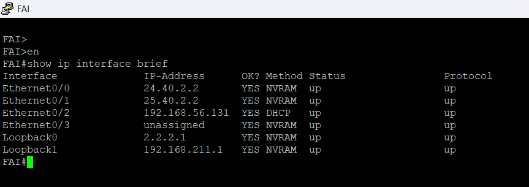
  <br>
  <em>FAI: show ip interface brief : e0/0, e0/1 et e0/2 en up/up, e0/2 avec adresse obtenue par DHCP</em>
</p>

<p align="center">
  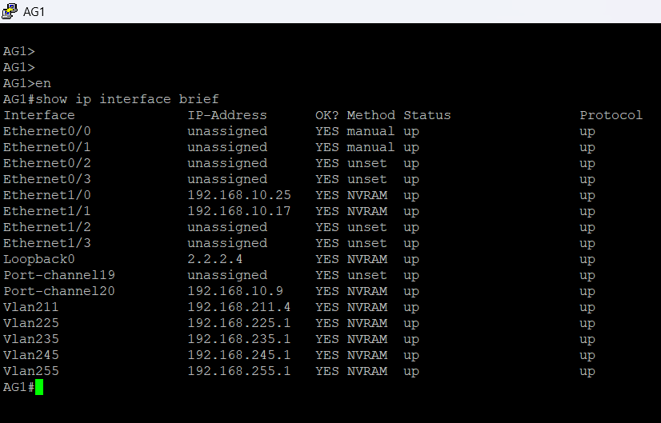
  <br>
  <em>AG1: show ip interface brief : liens routés e1/0 et e1/1, Port-channel 20 routé, Port-channel 19 et SVIs VLAN 211/225/235/245/255 en up/up</em>
</p>

<p align="center">
  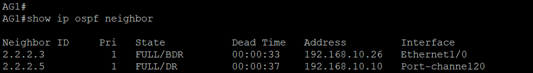
  <br>
  <em>AG1: show ip ospf neighbor : adjacences FULL avec RO-11, RO-12 et AG2</em>
</p>

<p align="center">
  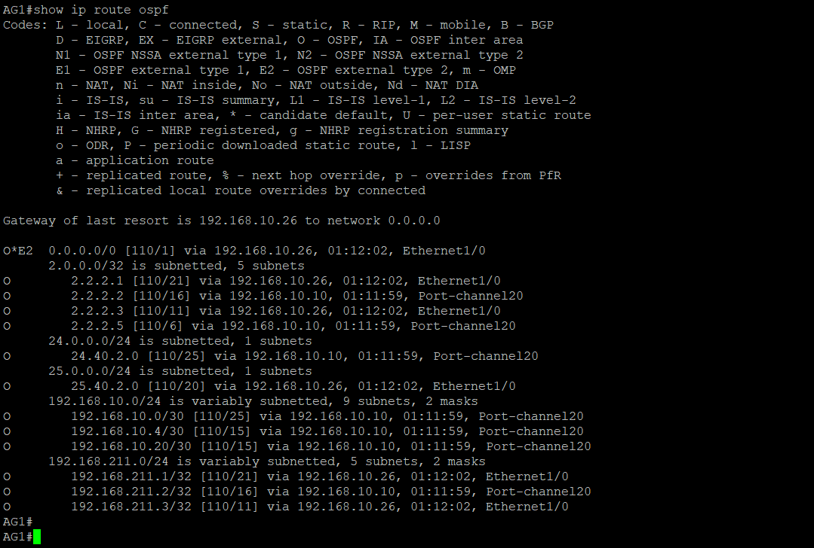
  <br>
  <em>AG1: show ip route ospf : routes apprises en OSPF et route par défaut issue de FAI</em>
</p>

---

### Switching L2

<p align="center">
  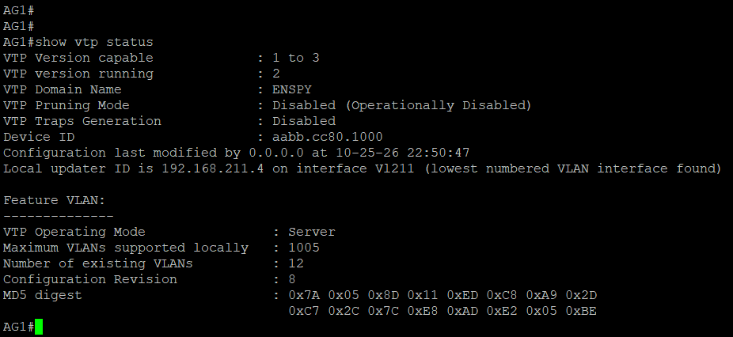
  <br>
  <em>AG1: show vtp status : domaine ENSPY, version 2, mode serveur</em>
</p>

<p align="center">
  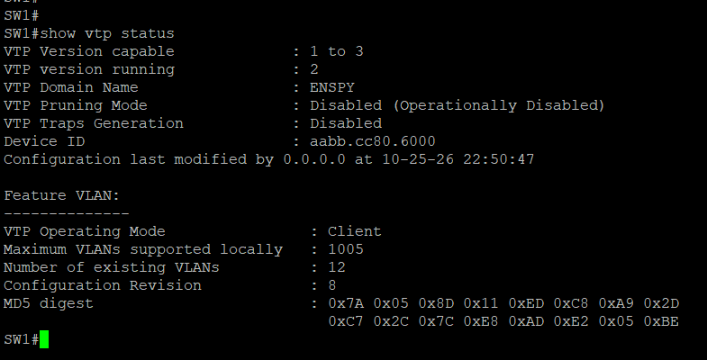
  <br>
  <em>SW1: show vtp status : domaine ENSPY, mode client, VLANs appris depuis AG1 et AG2</em>
</p>

<p align="center">
  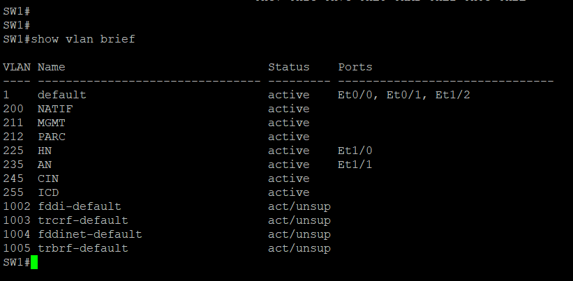
  <br>
  <em>SW1: show vlan brief : VLAN 225 (PC17) et VLAN 235 (PC18) attribués aux ports d'accès</em>
</p>

<p align="center">
  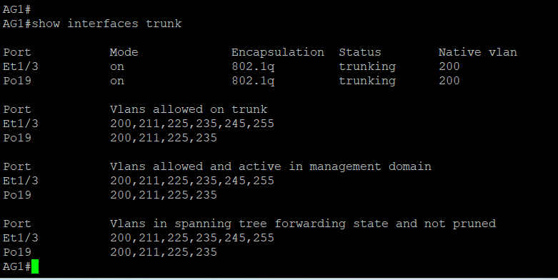
  <br>
  <em>AG1: show interfaces trunk : Po19 et e1/3 en trunk 802.1q, VLAN natif 200</em>
</p>

---

### Haute disponibilité

<p align="center">
  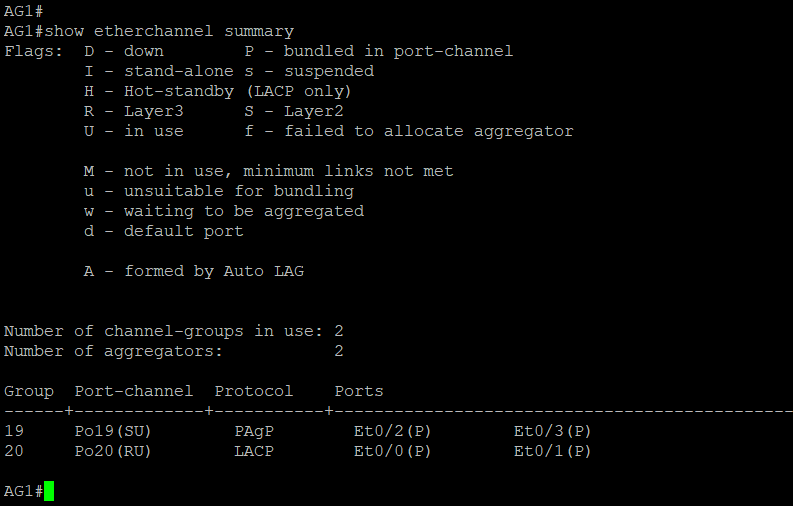
  <br>
  <em>AG1: show etherchannel summary : Po19 (PAgP) et Po20 (LACP) en statut SU, ports bundled</em>
</p>

<p align="center">
  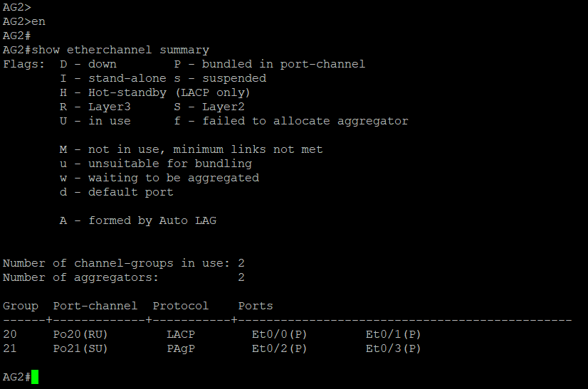
  <br>
  <em>AG2: show etherchannel summary : Po20 (LACP) et Po21 (PAgP) en statut SU, ports bundled</em>
</p>

<p align="center">
  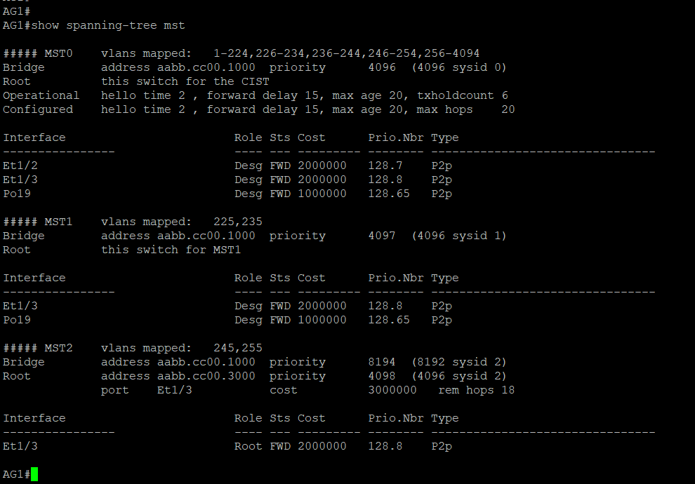
  <br>
  <em>AG1: show spanning-tree mst : racine des instances 0 et 1, AG2 racine de l'instance 2</em>
</p>

<p align="center">
  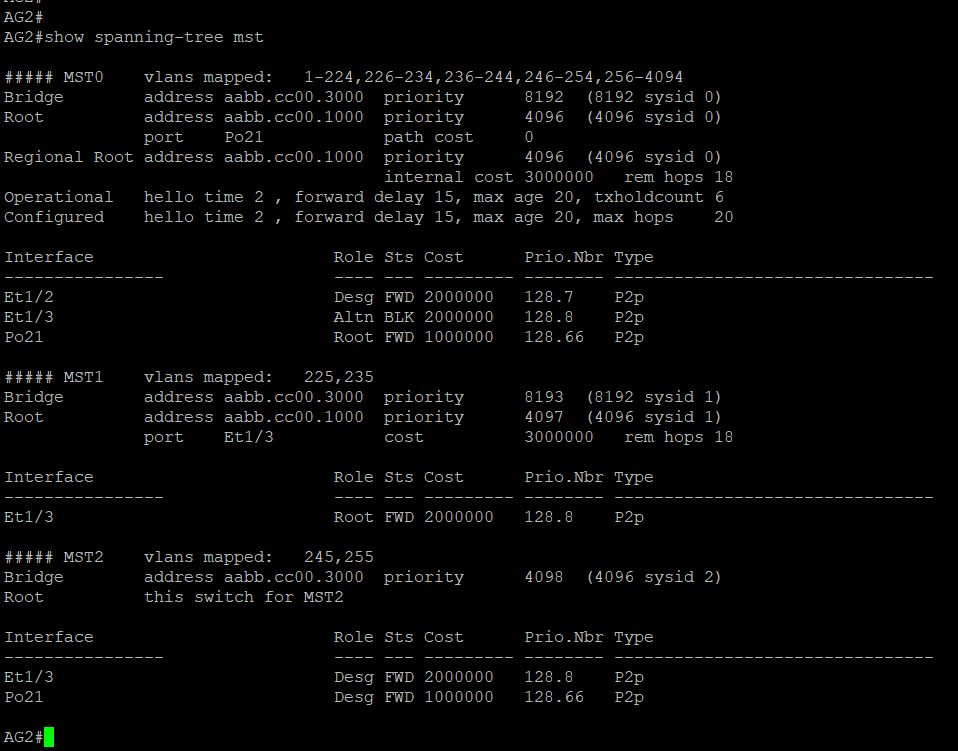
  <br>
  <em>AG2: show spanning-tree mst : racine de l'instance 2, répartition de charge avec AG1 sur les liens d'accès</em>
</p>

<p align="center">
  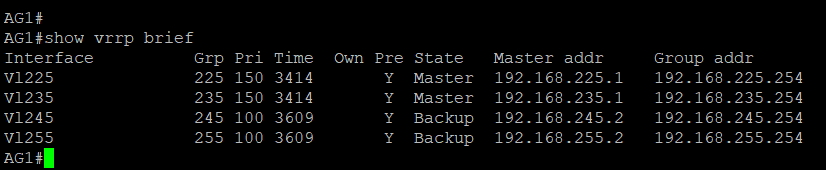
  <br>
  <em>AG1: show vrrp brief : Master sur les VLANs 225 et 235 (priorité 150), Backup sur 245 et 255</em>
</p>

<p align="center">
  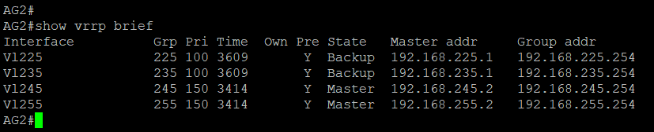
  <br>
  <em>AG2: show vrrp brief : Master sur les VLANs 245 et 255 (priorité 150), Backup sur 225 et 235</em>
</p>

---

### Services

<p align="center">
  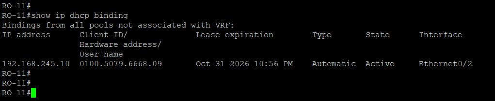
  <br>
  <em>RO-11: show ip dhcp binding : baux distribués dans la moitié basse des pools</em>
</p>

<p align="center">
  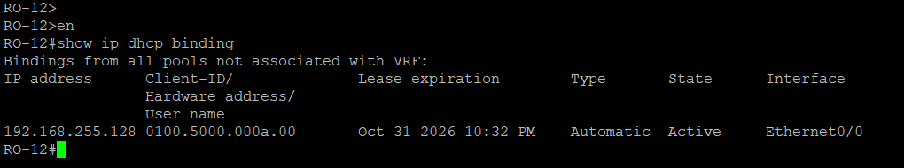
  <br>
  <em>RO-12: show ip dhcp binding : bail 192.168.255.128 (VLAN 255) distribué dans la moitié haute du pool</em>
</p>

<p align="center">
  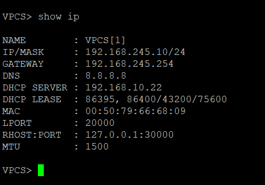
  <br>
  <em>VPC: show ip : adresse 192.168.245.10/24, passerelle VRRP 192.168.245.254 et DNS obtenus par DHCP (VLAN 245)</em>
</p>

<p align="center">
  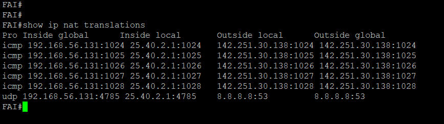
  <br>
  <em>FAI: show ip nat translations : flux de RO-12 (25.40.2.1) traduits vers l'adresse 192.168.56.131 de e0/2</em>
</p>

---

### Tests de validation

<p align="center">
  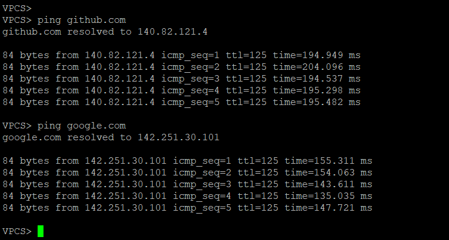
  <br>
  <em>VPC: ping github.com et google.com : résolution DNS et connectivité Internet de bout en bout validées (VLAN 245)</em>
</p>

<p align="center">
  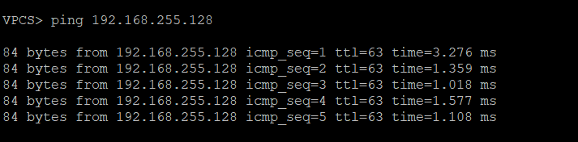
  <br>
  <em>VPC (VLAN 245): ping vers 192.168.255.128 (VLAN 255) : routage inter-VLAN validé</em>
</p>

<p align="center">
  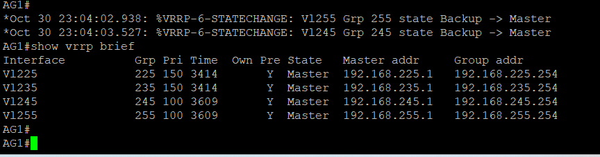
  <br>
  <em>AG2 arrêté : AG1 passe Master sur les VLANs 245 et 255 (messages %VRRP-6-STATECHANGE) et assure les 4 passerelles</em>
</p>
